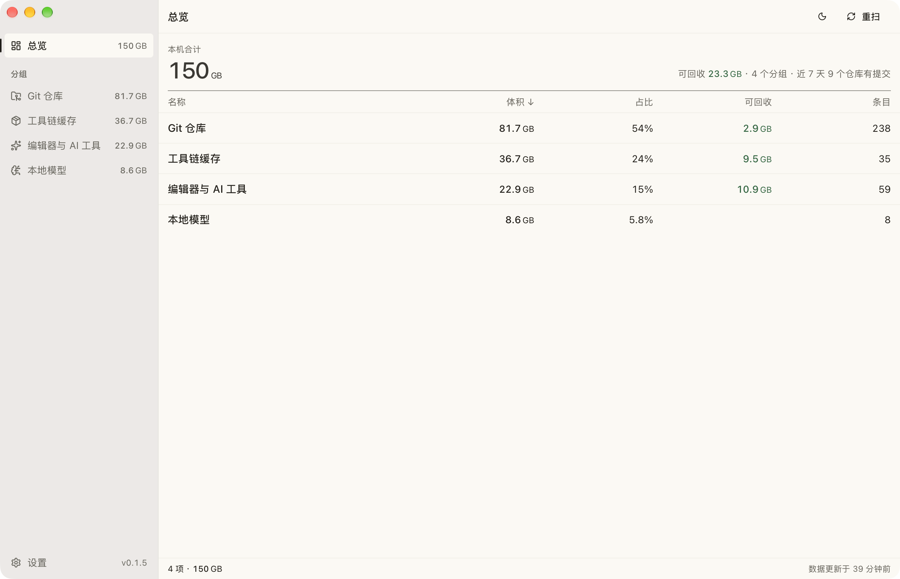
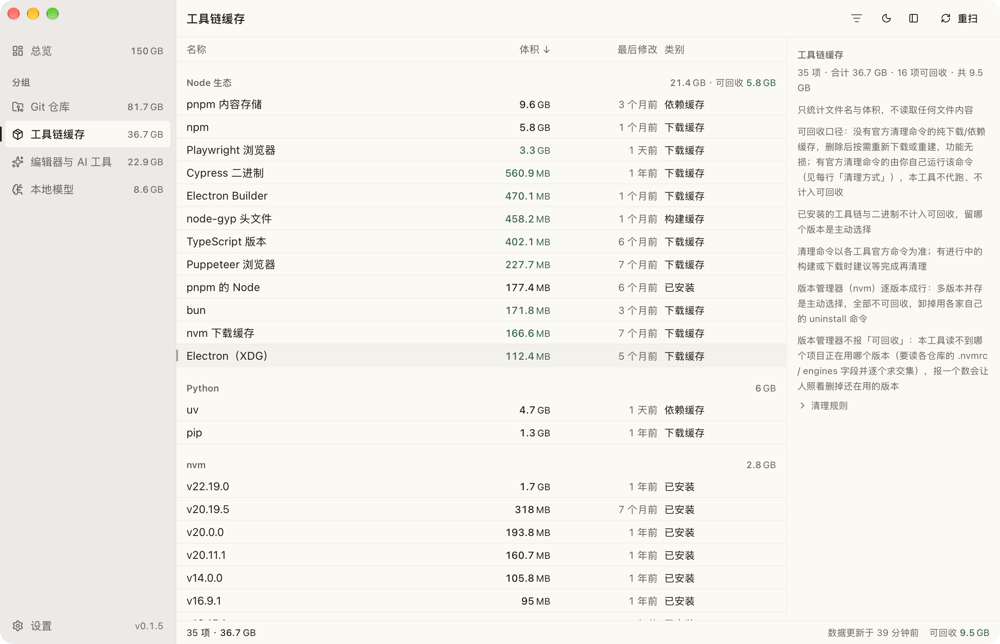

# Stacktake

[简体中文](./README.md) | English

A ledger of your dev machine's assets — see what has actually piled up on the disk, and what's safe to clear.

The UI follows your system language and can be pinned in Settings: 简体中文 / 繁體中文 / English / Español / 日本語, with English as the fallback for everything else (Español / 日本語 / 繁體中文 are first drafts, native review pending).

## What problem it solves

A dev machine's disk doesn't fill up because of one huge file. It fills up slowly, eaten by hundreds of directories nobody dares to touch:

- **Build artifacts**: `node_modules` / `target` scattered across two or three hundred repos. Regenerable — but nobody remembers which projects are still active.
- **Package-manager caches** in the tens of GB; some have an official cleanup command, some are safe to move wholesale, and it's hard to tell which is which.
- **Stale versions**: version managers hold a whole row of Node / Python installs, the oldest ones still eating disk — but which versions do live projects still use?
- **AI coding tools' logs and sessions** growing quietly — logs are safe to delete, sessions don't come back, and every vendor names their folders differently.
- **Local models**, several GB each — assets you'd have to re-download, not caches.

Generic disk tools (DaisyDisk, the OS storage page) answer "**what's big**" but not "what can go". CleanMyMac-style cleaners will delete for you — and will break a development environment just as readily. Stacktake takes the middle road: an asset ledger that reports "what takes space" and "what is safe to delete" **separately**. It knows these directories — which artifacts are regenerable, which caches have an official cleanup command, which things won't come back once deleted — so every row's Reclaimable / Cleanable figure has stated criteria. Whether to delete, and what, stays your call. Everything is read-only except the clean actions of three groups (Git repositories / Toolchain caches / Editors & AI tools); cleaning moves items to the Trash, so it's reversible.





## Install

Download the latest build from [Releases](https://github.com/twoer/stacktake/releases):

- **macOS**: Apple Silicon (M-series), macOS 11 or later;
- **Windows**: Windows 10 / 11, x64.

Or build from source:

```bash
npm install
npm run tauri build
```

Artifacts land in `src-tauri/target/release/bundle/`.

**First launch on macOS**: builds are ad-hoc signed (code signature and resource seal are valid, but there is no Apple notarization), so Gatekeeper blocks a browser-downloaded copy once with "Apple could not verify that it is free of malware". Any one of these gets past it:

- System Settings → Privacy & Security → "Open Anyway" (appears after the first block);
- right-click the app in Finder → Open;
- or run `xattr -cr <file>` on the DMG once and mount it again.

Builds v0.1.3 and earlier have an invalid signature — macOS reports the app as "damaged" with no override at all. Fixed since v0.1.4; use the latest build.

**First run on Windows**: installers are not code-signed, so SmartScreen shows "Windows protected your PC" — click "More info" → "Run anyway".

**Updates**: check and download from the Settings page. This path skips browser quarantine, so neither of the notes above applies; when the download finishes, it opens the installer and quits the app. If you drag the new .app over the old one by hand instead, **quit Stacktake first** — a running .app can't be replaced and Finder reports it as "in use" (the Windows NSIS installer stops the running process for you).

## What it scans

> All sizes and counts below are **one scan snapshot of the author's machine, 2026-10-21**. They show what the UI looks like — not what to expect on yours. "GB" in the UI and here means GiB (2³⁰) — about 7% **smaller** than Finder's decimal GB for the same data. The snapshot: 4 groups / 340 entries / 149.3 GB, of which 23.2 GB reclaimable.

- **Overview**: the whole machine at a glance — one row per group (size / reclaimable / entries); click a row to open that group.
- **Git repositories** (238 entries / 81.1 GB, of which 2.9 GB is regenerable build artifacts): which repo is big, which has gone quiet, which has unpushed commits — one row each. Repos holding build artifacts (`node_modules` / `target` etc., matched by a name whitelist plus project-marker files) get a "Build output" tag and separate accounting — artifacts are regenerable, so cleaning them while keeping the source is often the higher-frequency move; you can also tick just some artifact directories.
- **Toolchain caches** (35 entries / 36.7 GB, of which **9.5 GB cleanable**): package-manager and language-runtime caches, plus version managers broken out one row per installed version — not "nvm: 2.8 GB" but "of 9 Node versions, v22.19.0 alone takes 1.7 GB, and the oldest, v12.18.0, still holds 0.08 GB".
- **Editors & AI tools** (59 entries / 22.8 GB, of which **10.8 GB cleanable**): AI tools name their folders with nothing in common — one tool's `logs` is another's `log`. So this group doesn't model tools; it models semantic categories: logs, sessions, caches, skills, indexes, config, runtimes, unknown. **The category decides cleanability; the tool is just an attribution label** — filter by "Cleanable" to see them across tools, without memorizing anyone's directory names. Editors follow the same rules: extensions and installed tools aren't reclaimable; logs / GPUCache / index caches are.
- **Local models** (8 entries / 8.6 GB): the model lists of Ollama / LM Studio / HuggingFace. A model's size counts the weight blobs it references (shared layers counted once per row).
- **WSL distros** (appears on Windows only): every WSL2 distro is a single `ext4.vhdx` on the host — its size is the disk that distro eats. Reads the registry and file metadata only; runs no wsl commands and never enters a distro.

A few more groups (Java, iOS / Android / HarmonyOS, Docker, SSH) are **hidden from the sidebar by default** — which is why the Overview total deliberately under-reports.

## Privacy and security boundaries

A tool that dares to delete on your behalf owes you an account of what it doesn't touch. These are design premises, not disclaimers:

- **No credentials, ever**: no private keys, never enters `~/.ssh`; the AI-tools group reads file names only, never file contents — credentials never enter the data flow, as opposed to "read it, then scrub it". The single exception is Ollama's manifest JSON (Local models group): it's a layer manifest containing no credentials, and without reading it there is no way to know which weight blobs a model references.
- **Scanning is whitelist-based** — known paths only; no globbing `~/.*` or all of `~/Library/Caches`.
- **Reveal, never open.** "Reveal in Finder" / "Show in File Explorer" and "Copy path" write nothing and execute nothing; there is deliberately no "Open" — opening a path executes it (`.app` / `.command` / installers all run). It won't run user-level commands for you either: official cleanup commands like `pnpm store prune` are shown per row under cleanup rules, for you to run yourself. "Execute on your behalf" is a door that stays shut.
- **No listening ports** — not an HTTP service, no cross-origin attack surface. That is the main reason it's Tauri rather than a web app.
- **Cleaning is the only write action, enabled for three groups only** (Git repositories / Toolchain caches / Editors & AI tools). The dialog lists every path and byte count about to move to the Trash; nothing happens until you confirm. Items go to the Trash, not permanent deletion, and stay recoverable. The backend doesn't trust ids coming from the frontend — it re-checks every entry against the whitelist before acting. **Sessions hold your full conversation history and code snippets and are not rebuilt automatically**; the dialog calls this out separately. Every other group stays read-only.

Found a security vulnerability? Please use the private channel described in [SECURITY.md](./SECURITY.md) rather than opening a public issue.

## How to read the numbers

These aren't implementation details; they're what each number on screen means:

- **Sizes are disk usage, not logical bytes.** What deleting a directory actually frees is its usage: on APFS/HFS+, compression, clones and sparse files pull logical size far away from usage, and computing "reclaimable" from logical size overstates it. On Unix this matches `du`; within a single traversal, hard links dedupe by (dev, inode) — hard links shared across entries count once each, so row sums can exceed the global unique byte count.
- **"Cleanable" means clicking it will really delete it** — not "deleted, re-downloaded on demand". Caches with an official cleanup command (npm / pnpm / uv / pip / Homebrew / Go / Deno / NuGet / Composer etc.) are **never marked Cleanable**; the command is shown per row for you to run — `pnpm store prune` only drops unreferenced packages, far more precise than moving the whole store. The tradeoff: those rows' reclaimable figures are visibly smaller than the folders on disk.
- **Version managers list one row per installed version, and none are ever reclaimable.** Collapsing to one row yields just "2.8 GB"; the useful fact is "of 9 Node versions, v22.19.0 alone takes 1.7 GB, and the oldest still holds 0.08 GB". Whether a version can go depends on which projects still use it; this tool doesn't read project files, and reporting a reclaimable number would get versions still in use deleted. To uninstall, use each manager's own uninstall command (shown in the row's details).
- **Models are assets, not caches.** Deleting one means re-downloading tens of GB, so Local models never shows reclaimable; the ledger's value is "which models are installed, how big each one is". A model's size counts the weight blobs it references (shared layers counted once per row), not a plain file-size sum.

The full accounting details for sizes and local models (hard-link dedup scope, the 60-second timeout, manifest specifics) are in [docs/known-limits.md](./docs/known-limits.md).

## Scan policy

**It opens from cache; launching never triggers an unconditional scan.** With a cache, the window has content in milliseconds; a real scan happens only when there is no cache (first run). When the oldest group in the cache is older than 24 hours, the app shows the cache first, then rescans once in the background (on by default; off in Settings) — at most once a day, not on every launch: data changes so slowly (of hundreds of repos, usually only single digits have commits in the last 7 days) that more frequent rescans buy no freshness and just grind the disk for tens of seconds on every open. What you see may still be a snapshot from hours ago — the header always shows "data updated X ago". Rescan comes in two granularities: in a group view it rescans just that group (seconds); only the Overview triggers a full scan. The automatic refresh after a clean likewise rescans only the cleaned group. Since groups refresh at different times, the status bar's "updated" timestamp follows the group the current view shows.

A full scan measured **28.8 s** (4 groups / 340 entries, 2026-10-20, debug build — release is faster). The bottleneck is directory size accounting — a native traversal, not shelling out to `du`; running the size-heavy groups in parallel claws back only part of the time, so "every heavy group added makes rescans slower" has no parallelism safety net.

## Known limitations

- Size accounting via native traversal is the only bottleneck of a full scan. A few unusually large directories hit a **real timeout** (60 s, checked at every recursion level); those entries show `—`.
- **AI-tool classification matches folder names**, covering roughly 60%. Unrecognized entries land in "Unknown" with cleaning disabled — the cost of a miss is only under-reported reclaimable space, never a wrong deletion.
- A parent repo's size already excludes nested repos, but the parent/child test is `Path::starts_with`; nesting across volumes isn't detected.
- **Git repositories scans six common locations by default** (`~/Documents/Code`, `~/Projects`, `~/Developer`, `~/code`, `~/src`, `~/workspace`). If your code lives on another disk or elsewhere, click "add folder" from the group's empty state, or manage "Git repositories scan folders" in Settings. Default locations are read-only; removing an added folder deletes nothing; folders that overlap the existing scope (the same path, or a parent/child of one) are rejected rather than silently merged. Other groups don't honor env-var overrides like `NVM_DIR`.
- **Toolchain caches and AI tools are whitelists**; app caches like LarkShell or WeChat DevTools aren't included. Confirm the deletion consequences before adding a source.
- **No hard-link dedup on Windows** (`file_index` isn't stable): sizes there can only over-report, never misreport.
- **WSL sizes aren't what the distro actually uses, and they only grow**: deleting files inside the distro leaves holes in the virtual disk, and the Windows-side size doesn't move. Reclaiming that space takes three steps (`sudo fstrim -av` → `wsl --shutdown` → `Optimize-VHD -Mode Full`) — shown in the UI; this tool performs none of them. WSL1 has no virtual disk and shows `—`. The registry/metadata reads haven't been exercised on a real Windows machine (the dev machine is macOS).
- Every figure above is one local snapshot, not a promise. Numbers drift on rescan; the magnitudes hold.

## Development

```bash
npm install
npm run tauri dev
```

Verification runs in three gates — run the one that matches your change, and stop on red: `npm run verify:quick` (inner: fmt + clippy + type check + frontend unit tests + doc gate, seconds, run after every change) → `npm run verify` (outer: inner + tests + build, before committing) → `npm run verify:full` (eval: outer + full-scan contract check). Export a scan as JSON for manual inspection: `cd src-tauri && cargo run --example dump`. Run the tests (read-only against real local data, no writes): `cd src-tauri && cargo test`.

Rust 1.93 / edition 2024 / Tauri 2 / Vue 3 / Tailwind v4; the rsproxy mirror in `src-tauri/.cargo/config.toml` must stay committed (direct crates.io access times out from mainland China). Data contracts, scanner registration and frontend constraints: [AGENTS.md](./AGENTS.md).

## License

[MIT](./LICENSE).
